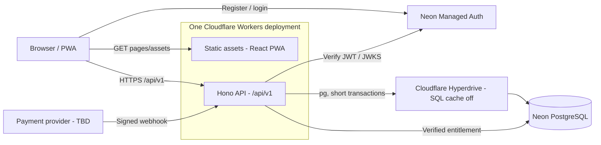
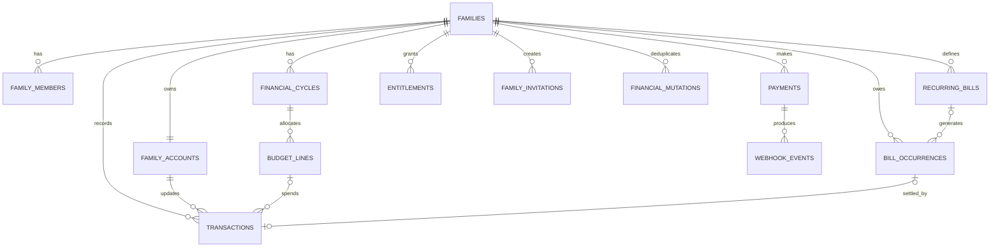
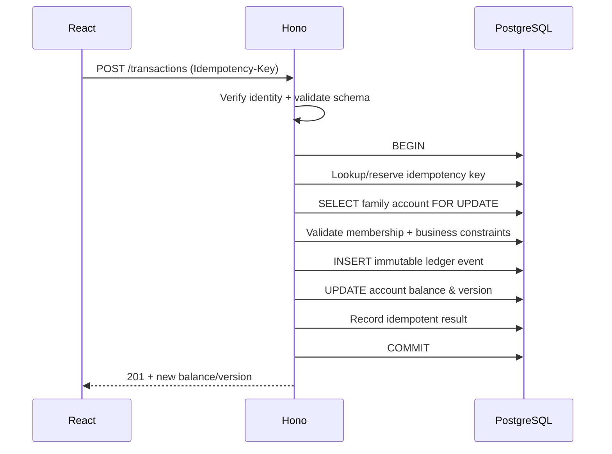

# TECHNICAL DESIGN DOCUMENT (TDD) — Family Finance App

| Metadata | Nilai |
|---|---|
| Versi | 0.1.0 — engineering baseline |
| Tanggal | 19 Oktober 2026 |
| Status | **Proposed / implementation-ready for POC**, not yet production-approved |
| Related | `docs/PRD.md`, `docs/USER_FLOW.md`, `docs/WIREFRAMES.md` |
| Constraint | Infrastructure spending Rp0 at prototype/MVP development |
| Scope | Mobile-first PWA, max. 2 adults/family, shared finances, deterministic “Boleh Checkout?” |

> **Aturan perubahan:** PRD menjelaskan *what/why*, USER_FLOW dan WIREFRAMES menjelaskan pengalaman pengguna, TDD ini menjelaskan *how*. Bila bertentangan, jangan diam-diam memilih: dokumentasikan konflik dan ajukan keputusan product/engineering. Fitur P0 boleh diimplementasikan bertahap, bukan seluruhnya dalam satu prompt Codex.

## 1. Executive decisions

### 1.1 Stack

| Layer | Keputusan awal | Alasan / batas |
|---|---|---|
| Frontend | React + Vite + TypeScript | SPA/PWA; tidak butuh SSR dashboard |
| Routing / server state | React Router + TanStack Query | Navigasi client, fetch/cache terkontrol |
| Styling / UI | Tailwind CSS + komponen internal yang accessible | Ringan, mobile-first; tidak perlu design system rumit |
| Validation | Zod di API boundary, validasi UI untuk UX | Server tetap authoritative |
| Backend | Cloudflare Workers + Hono, REST `/api/v1/*` | Satu deployment bersama static frontend |
| Database | Neon PostgreSQL Free | Relasional, ACID, 1 GB/project pada 2026-10-02 |
| DB transport | Cloudflare Hyperdrive **cache disabled** + `pg` | Interactive transactions, pooled connections; *fresh read* |
| ORM / migration | Drizzle ORM + Drizzle Kit | Typed queries, versioned migration |
| Authentication | Neon Managed Better Auth (`@neondatabase/auth`) | Managed login; **backend JWT verification MUST pass POC** |
| API token verification | `jose` + provider JWKS, verify issuer & applicable audience | Never trust unsigned/decoded client claims |
| Testing | Vitest + PostgreSQL integration + Playwright smoke | Domain calculation, tenant security, concurrency |
| CI/CD | GitHub Actions + Cloudflare deployment | Deploy after checks, secrets outside Git |
| Payment | Provider TBD, adapter + verified webhook | Development in sandbox only until provider selected |

**Architecture:** modular monolith. **Not selected:** microservices, MongoDB, custom password/auth implementation, AI, OCR, bank sync, background job service. Software versions are pinned at implementation time (lockfile) after testing with current official docs.

### 1.2 Important technical corrections

1. `drizzle-orm/neon-http` **does not support interactive `db.transaction(async tx => ...)`**. Financial writes require `pg` through Hyperdrive, or validated equivalent. Do not silently switch to Neon HTTP for financial mutations.
2. Hyperdrive caches eligible `SELECT` by default and **does not invalidate cached SELECT after writes**. Configure **one cache-disabled Hyperdrive binding** for all family/auth/billing/financial reads and writes; add public-cache strategy only later.
3. Cloudflare Workers Free has a published limit of **100,000 dynamic Worker requests/day, 10 ms CPU/request**, separate from static asset serving; Hyperdrive Free includes **100,000 database queries/day**. These are limits, **not SLA**.
4. Neon Free presently offers **1 GB storage and 100 CU-hours/project/month** plus Managed Better Auth (up to 60,000 MAU). Capacity is not equivalent to availability guarantees.
5. Working login in React **does not prove API authorization works**. Gate deployment on signed-token verification, membership authorization and cross-family tests.

## 2. Context & architecture



Single origin preferred: `https://<app-host>/` for SPA, `/api/v1/*` API, and `/health` health check. Worker routing is explicit so `/api/*` never falls through to SPA `index.html`.

**Data flow:** UI → Hono route → auth middleware → family membership/entitlement middleware → validated domain service → transactional repository/Drizzle → PostgreSQL. Core monetary calculations live in `packages/domain` as pure functions, **never duplicated** in React JSX.

**Security boundaries:** Browser and provider callbacks are untrusted. Worker has DB privileges; family membership and owner role are checked by the Worker against fresh DB state. Neon Auth determines *identity*, not entitlement or family authorization.

### 2.1 Local / staging / production

- Local: React/Vite + Wrangler dev + **separate dev Neon project/branch**; no customer data.
- Staging: separate Neon project or isolated branch with auth endpoint and secrets per environment; fake payments/sandbox.
- Production: independent DB credentials + auth branch + Workers config + payment webhook secret; no sample data.
- Preview deployments never point to production DB or production Auth.
- Never embed DB passwords, webhook signing secrets, or private Auth credentials in `VITE_*` variables.

### 2.2 Required proof of concept (BLOCKER before feature development)

Implement and test in the actual Workers runtime:

1. React → Neon Auth sign in → authenticated `GET /api/v1/me` with a verifiable signed JWT/session exchange, **including invalid/expired token rejection**.
2. Worker → Hyperdrive cache-disabled → Neon via `pg` + Drizzle: `SELECT 1`.
3. Within one `db.transaction(...)`, insert transaction + update account, intentionally throw and verify rollback; then verify committed values are immediately readable.
4. Run concurrent balance mutation requests using two authenticated users from same family; assert both accounted for exactly once.
5. Verify JWT `issuer`, signature, temporal claims and `audience` if issued; establish behavior for logout/revocation and short-lived tokens. **Do not infer the JWKS URL or token type from sample code**; use configured provider discovery/docs and a real issued token.
6. Verify local `wrangler dev`, deployed Worker, and Neon production-like branch run with acceptable CPU and no forbidden Node API.

**Stop/go:** If managed auth cannot be safely integrated with this Hono API within the intended scope, document the POC results and adopt a vetted alternative—do not create custom credential tables as a shortcut. If Hyperdrive requires paid access for an account/region or hits a blocker, reassess the transport before implementing ledger.

## 3. Domain boundaries

| Module | Responsibility | Depends on |
|---|---|---|
| identity | Auth verification, user profile view | Neon Auth/JWKS |
| family | Create shell, roles, invitation, seats | Identity, DB |
| billing | Payment lifecycle, entitlements | Family, payment provider |
| onboarding | Initial money state and financial cycle | Family, ledger, budget, bills |
| ledger | Immutable monetary events, cached account balance, reconciliation | DB transactions |
| budget | Essential allocations, cycles, category mapping | Ledger |
| bills | Recurring templates, due occurrences, bill settlement | Ledger |
| simulation | Pure calculation using consistent financial snapshot | Ledger, budget, bills |
| analytics | Non-sensitive funnel event names only | Consent/marketing config |

No module may directly modify ledger balance outside the ledger service. No external provider calls inside database transactions.

## 4. PostgreSQL data design

### 4.1 Modeling conventions

- Primary keys: UUID (generated server-side/DB), timestamps: `timestamptz` in UTC.
- Business dates: PostgreSQL `date` as **Asia/Jakarta local date**; API uses `YYYY-MM-DD`.
- Amounts: signed/unsigned `BIGINT` as **whole IDR**, never `float`/`double`. JSON amounts are **decimal strings** (`"150000"`) to preserve precision. Convert to `bigint` in domain service and explicitly stringify for JSON.
- `family_id` must scope each family-owned table and all reads/mutations.
- `created_at`, `updated_at`, and relevant `created_by_auth_user_id` are audited; avoid exposing internal IDs unnecessarily.
- Constraints and unique indexes **backstop** application validation.
- One family per user in MVP; family max 2 adults, enforce inside locked membership transaction (not only in UI).

### 4.2 Entity relationships



### 4.3 Table contract (minimum columns)

| Table | Key columns / constraints |
|---|---|
| `families` | `id uuid PK`, `name text`, `status enum(pending_payment,pending_setup,active,suspended)`, `payday_day smallint CHECK 1..31`, `protected_reserve_idr BIGINT CHECK >=0 DEFAULT 0`, `created_at` |
| `family_members` | `(family_id, auth_user_id)` unique, `auth_user_id text UNIQUE` (one family per user), `role enum(owner,member)`, `joined_at` |
| `family_invitations` | `id`, `family_id`, `token_hash UNIQUE`, `expires_at`, `used_at nullable`, `invited_by`, `created_at`; never store raw invite token |
| `family_accounts` | `id`, `family_id UNIQUE`, `balance_idr BIGINT CHECK >=0`, `version BIGINT`, `last_reconciled_at` |
| `financial_cycles` | `id`, `family_id`, `starts_on date`, `next_payday_on date`, `status enum(active,closed)`, `budget_reviewed_at nullable`, UNIQUE `(family_id,starts_on)`, non-overlapping intervals |
| `budget_lines` | `id`, `family_id`, `cycle_id`, `label`, `allocated_idr BIGINT CHECK >=0`, `kind enum(essential)`, unique family/cycle/label policy decided by UX; bill allocations are **not** budget lines |
| `recurring_bills` | `id`, `family_id`, `name`, `amount_idr >0`, `due_day 1..31`, `active`, `created_at` |
| `bill_occurrences` | `id`, `family_id`, `recurring_bill_id nullable`, `due_on`, `amount_idr >0`, `status enum(unpaid,paid)`, `paid_transaction_id nullable UNIQUE`, CHECK paid iff payment txn is linked, UNIQUE `(recurring_bill_id,due_on)` where recurring ID exists |
| `transactions` | `id`, `family_id`, `account_id`, `cycle_id`, `occurred_on`, `kind enum(opening_balance,income,expense,reconciliation,reversal)`, `expense_type enum(essential,bill,discretionary) nullable`, `delta_idr BIGINT`, `budget_line_id nullable`, `bill_occurrence_id nullable`, `reversal_of_id nullable UNIQUE`, `reversed_at nullable`, `created_by_auth_user_id`, `created_at` |
| `financial_mutations` | `id`, `family_id`, `actor_auth_user_id`, `idempotency_key`, `request_hash`, `result_type`, `result_id`, `created_at`, UNIQUE `(family_id,idempotency_key)` |
| `payments` | `id`, `family_id`, `provider`, `provider_order_id UNIQUE`, `status`, `amount_idr`, `created_at`, `paid_at` |
| `webhook_events` | `id`, `provider`, `provider_event_id`, `payment_id nullable`, `payload_hash`, `handled_at`, UNIQUE `(provider,provider_event_id)` |
| `entitlements` | `id`, `family_id`, `payment_id UNIQUE`, `status enum(active,revoked)`, `starts_at`, `ends_at nullable`, `created_at` |

`auth_user_id` matches Neon Auth's identity `sub` and is `text` to avoid assuming provider ID format. No direct mutable auth password fields in application tables. Family email/profile is obtained from verified identity or a minimal account profile mapping if needed.

**Tenant integrity:** Foreign keys for child tables should use `(family_id, parent_id)` composite references (plus matching unique constraint) when there is risk of accidentally linking an object from another family. A plain `bill_occurrence_id` reference without tenant matching is insufficient as a cross-family guard.

**Account invariant:** `family_accounts.balance_idr = SUM(transactions.delta_idr)` for the same account, including opening, corrections and reversals. Enforce **all account changes in one DB transaction**, never manual UPDATE alone.

### 4.4 Ledger semantics and corrections

- `opening_balance`: positive initial delta during onboarding; if zero, leave ledger empty and balance zero (do not create zero transaction).
- `income`: positive delta, **only when actually received**.
- `expense`: negative delta; `expense_type` determines treatment by budget or bill. Bills may never also be essential-budget consumption.
- `reconciliation`: delta = newly confirmed balance − current balance, may be positive/negative; resulting balance must be nonnegative, records who/when confirmed; **does not automatically mark bills paid or consume essential budget**.
- `reversal`: immutable compensating delta `−original_delta`; links `reversal_of_id` and flags original `reversed_at`. Total ledger remains auditable.
- User-facing **edit/delete** is implemented as reversal (+ replacement when editing) in a single transaction; never physically remove historical ledger rows. Editing/reversing a paid bill also atomically reopens/updates its bill occurrence and associated linkage. To avoid inconsistent circular references, insert the settlement transaction first and update `bill_occurrences.paid_transaction_id` in the same database transaction; use explicit domain validation and appropriate (possibly deferred) constraints.
- Corrections to past periods recompute projections/budget consumption from active effective expenses, not from historical reversal rows.
- Expense greater than actual account balance is rejected with `INSUFFICIENT_BALANCE` in MVP; **negative available-to-spend is allowed**, but **negative real shared cash balance is not modeled**.

### 4.5 Financial cycle rules

- Config `payday_day` is integer 1–31. For each month compute `paydayDate = min(configured_day, lastDayOfMonth)`; recalculate from configured day every month (31 Jan → 28 Feb → 31 Mar).
- Active cycle is `[previous_payday_date, next_payday_date)` in local calendar dates. Example payday 25: Sep 25–Oct 24 then Oct 25–Nov 24.
- Current local date in `Asia/Jakarta` sets active cycle; clock timestamps stored UTC. Tests cover leap years, year changes, `31`-day payday, and timezone boundary.
- Future income does not increase current balance until manually recorded as received.
- Unpaid bills with `due_on < next_payday_on` are reserved, **including overdue bills**. Later bills are excluded from this cycle.
- Every bill must have a due date; no undated aggregated value can silently bypass calculations. A one-off “tagihan gabungan” is just one explicit occurrence with due date, **never added on top of its individual bills**.
- Recurring template → occurrence creation must be idempotent using UNIQUE `(recurring_bill_id,due_on)`; generation happens via explicit `POST /api/v1/bootstrap` after sign-in/on cycle transition. No cron dependency in MVP.
- No overlap/duplicate active cycles for a family; serialize rollover by locking family/account row and using upserts.
- During rollover, **copy essential budget allocations from the previous cycle** as provisional values and flag the new cycle `needs_review` until confirmed. Without prior allocations, show `setup_incomplete` and do not present a misleading positive “aman dibelanjakan” number. Use `budget_reviewed_at` on `financial_cycles`.

## 5. Core calculation engine — “Boleh Checkout?”

### 5.1 Definitions

- `B` = actual shared balance from ledger snapshot.
- `U` = sum of unpaid bill occurrences due before next payday, including overdue.
- `E` = sum over essential budget lines of `max(allocated − sum(active expense amount assigned to line), 0)`.
- `R` = protected reserve configured by family (for current planning period).
- `P` = hypothetical proposed purchase, positive IDR.

```text
availableToSpend = B − U − E − R
remainingAfterPurchase = availableToSpend − P
shortfallAfterPurchase = max(−remainingAfterPurchase, 0)
```

Do **not** clamp `availableToSpend` to zero in calculations. If it is negative, render deficit explicitly. Display language: “estimasi masih dalam batas anggaran” / “berpotensi kekurangan dana”; not a financial guarantee.

### 5.2 Pure function reference (TypeScript pseudocode that can be unit-tested)

```ts
type SimulationInput = {
  balanceIdr: bigint;
  unpaidBillsIdr: bigint;
  remainingEssentialsIdr: bigint;
  protectedReserveIdr: bigint;
  purchaseIdr: bigint;
};

export function simulatePurchase(x: SimulationInput) {
  if (
    x.balanceIdr < 0n || x.unpaidBillsIdr < 0n ||
    x.remainingEssentialsIdr < 0n || x.protectedReserveIdr < 0n ||
    x.purchaseIdr <= 0n
  ) throw new Error('INVALID_SIMULATION_INPUT');

  const availableToSpendIdr =
    x.balanceIdr - x.unpaidBillsIdr -
    x.remainingEssentialsIdr - x.protectedReserveIdr;
  const remainingAfterPurchaseIdr = availableToSpendIdr - x.purchaseIdr;
  return {
    availableToSpendIdr,
    remainingAfterPurchaseIdr,
    shortfallIdr: remainingAfterPurchaseIdr < 0n
      ? -remainingAfterPurchaseIdr : 0n,
    withinPlan: remainingAfterPurchaseIdr >= 0n,
  };
}
```

Public demo uses the same pure function with sample input **only in browser memory**. Authenticated simulation obtains latest committed balance/bill/budget snapshot on backend, and returns strings for amounts; no mutation. Never use UI-entered `balanceIdr` as authority in authenticated simulation.

### 5.3 Financial invariants / example

Initial: `B=4,000,000`, `U=1,700,000`, `E=1,500,000`, `R=300,000`; available `500,000`. Proposed `P=750,000` → remaining `−250,000`.

| Event | Effect on B | Effect on U | Effect on E | Effect on available |
|---|---:|---:|---:|---:|
| Income received Rp100,000 | +100,000 | 0 | 0 | +100,000 |
| Pay already reserved bill Rp100,000 | −100,000 | −100,000 | 0 | **0** |
| Record essential spending Rp100,000 within budget | −100,000 | 0 | −100,000 | **0** |
| Discretionary purchase Rp100,000 | −100,000 | 0 | 0 | −100,000 |
| Reconcile cash to Rp100,000 lower | −100,000 | 0 | 0 | −100,000 |
| Simulate purchase | 0 | 0 | 0 | **0** |

**Critical caveats:**

1. For an essential expense exceeding the line's remaining allocation, `E` bottoms at 0; only the previously reserved portion offsets the decrease in `B`. Excess reduces available.
2. Paying a bill must write its expense and mark occurrence paid *together*. Do not mark a bill paid based on an unrelated generic expense.
3. Reconciliation can create under/over-reservation if unrecorded expenses were essential or bills. Present a review prompt; do not fabricate category allocations.
4. `budget_line_id` essential and `bill_occurrence_id` bill are mutually exclusive on a transaction; enforce DB CHECK/application invariants.
5. Two sessions doing operations at once cannot read stale `balance_idr` during a write. Lock account row `SELECT ... FOR UPDATE` in short interactive transaction; calculate delta, insert event, update balance/version, commit.
6. Within a request, snapshot assembly must be consistent: use an appropriate PostgreSQL transaction isolation level (e.g. repeatable-read read-only snapshot) **or** a single consistent SQL statement; verify actual implementation in integration tests.

## 6. Auth, tenancy & permissions

### 6.1 Authentication flow

1. Frontend authenticates via Neon Managed Better Auth's supported React client; provider issues identity/session token.
2. Frontend calls `/api/v1/*` with `Authorization: Bearer <short-lived JWT>` **only after JWT flow is validated by POC**; don't send an opaque session ID as if it were a JWT.
3. Worker verifies signature against provider JWKS with `jose`, and checks `iss`, `exp`, `nbf`, and expected `aud` when applicable. Reject invalid/expired tokens with 401.
4. Worker derives `auth_user_id` **only from verified subject**; ignores any client-sent actor ID.
5. Worker reads fresh `family_members` and `entitlements` for the route's family, then enforces `owner`/`member` permission.
6. CORS allowlist, rate limits on sensitive operations; consider CSRF protection if browser-cookie-based auth is chosen instead of Bearer.

If the current Neon SDK supports only proxy/session-cookie integration for a particular flow, implement the **documented server-side session validation** instead and update this section. No unverified JWT forwarding or self-signed token workaround.

### 6.2 Permission matrix

| Operation | Visitor | Member | Owner |
|---|---|---|---|
| Landing / anonymous demo | Yes | Yes | Yes |
| View shared finance | No | Yes (paid family) | Yes (paid family) |
| Simulate / add expenses / settle bill | No | Yes | Yes |
| Reconcile shared balance | No | Yes | Yes |
| Change family/payday/budget | No | Yes | Yes |
| Invite/revoke member | No | No | Yes |
| Checkout / entitlement / invoice | No | Read own family status only | Yes |
| View other family's data | **Never** | **Never** | **Never** |

**Invitation:** 256-bit random token encoded in URL, persist only SHA-256 hash; single-use, expiry (proposed 48 hours), consumed atomically alongside membership seat check. Use generic rejection errors; token must not appear in analytics/logs. Owner cannot remove themself if that leaves family without an owner; no transfer-ownership workflow in MVP.

### 6.3 Data handling

- Per-family authorization **on every service query**; no route fetches row by ID without checking family scope.
- Cache-Control `no-store` on authenticated finance responses. No private finance data in CDN caches, service-worker caches, browser LocalStorage, analytics payloads, or error logs.
- Audit who created/edited/reversed financial entries. Log ID/request IDs, status, latency, error codes, not financial amounts, auth tokens, passwords, invite links, or raw payment webhook bodies.
- Account delete/export and Privacy/Terms must be supported before public paid launch. Retention/deletion requirements reviewed with applicable Indonesian privacy obligations; this TDD is not legal advice.

## 7. API contract (REST v1)

### 7.1 Conventions

- Base `/api/v1`; JSON `Content-Type: application/json`; all IDR fields sent/received as **decimal strings**; dates local ISO `YYYY-MM-DD`, timestamps ISO 8601 UTC.
- `X-Request-ID` for trace; `Idempotency-Key` required on finance mutations and payment-intent creation; repeat same key+payload returns same result, reused key+different payload returns `409 IDEMPOTENCY_CONFLICT`.
- Common response `{ "data": ..., "meta": { "requestId": "..." } }`; errors `{ "error": { "code": "...", "message": "...", "details": [] }, "meta": { "requestId": "..." } }`.
- Validation and limits: 400 malformed JSON; 401 no identity; 403 unauthorized; 404 out-of-scope item; 409 conflicts/concurrency; 422 invalid domain state; 429 rate limit; 500 opaque server error.
- Use optimistic `version` in update requests or server-side row lock; do not silently overwrite edits from another family member.

### 7.2 Endpoints

| Method | Path | Key behavior |
|---|---|---|
| GET | `/health` | Public status without DB or secrets |
| GET | `/api/v1/me` | Verified identity, membership, family/entitlement status |
| POST | `/api/v1/families` | Owner creates pending-payment shell; idempotent per user |
| GET | `/api/v1/families/current` | Current family settings, role, membership |
| POST | `/api/v1/families/invitations` | Owner only; create expiring invite token |
| POST | `/api/v1/families/invitations/accept` | Authenticated, single-use token, atomic seat check |
| POST | `/api/v1/bootstrap` | Idempotently ensure active cycle and due bill occurrences |
| POST | `/api/v1/onboarding/complete` | Paid owner, atomically create opening balance + bills/budgets/cycle |
| GET | `/api/v1/dashboard` | Fresh financial snapshot + last reconciliation + breakdown |
| POST | `/api/v1/simulations` | Validated hypothetical amount, fresh read, **no writes** |
| GET | `/api/v1/transactions` | Cursor pagination, date/type/category filters |
| POST | `/api/v1/transactions` | Record received income or actual expense, atomic ledger write |
| PATCH | `/api/v1/transactions/:id` | Correct via reverse-and-replace inside one transaction |
| DELETE | `/api/v1/transactions/:id` | Logical reversal, no hard deletion; linked bill requires special settlement reversal |
| POST | `/api/v1/accounts/reconcile` | Set confirmed balance by compensating adjustment |
| GET/POST/PATCH | `/api/v1/budget-lines` | Fetch/create/change current cycle essential allocations |
| GET/POST/PATCH | `/api/v1/recurring-bills` | Manage recurring templates |
| GET/POST | `/api/v1/bill-occurrences` | Fetch/create ad hoc bill obligation |
| POST | `/api/v1/bill-occurrences/:id/pay` | Mark paid + linked expense, one database transaction |
| POST | `/api/v1/bill-occurrences/:id/reopen` | Undo settlement via ledger reversal, one transaction |
| POST | `/api/v1/checkout/sessions` | Owner paid-purchase initiation, server-side authoritative price |
| GET | `/api/v1/billing/status` | Verified purchase + entitlement state |
| POST | `/api/v1/webhooks/payment/:provider` | Raw-body signature verification; replay-safe status event |

For POC, first implement only `GET /health`, `GET /api/v1/me`, and one **non-public test-only DB transaction endpoint** that must be deleted/gated before production. Then implement module routes by milestone.

### 7.3 Example input/output — simulation

```http
POST /api/v1/simulations
Authorization: Bearer <valid-access-token>
Content-Type: application/json

{"purchaseAmountIdr":"750000","itemName":"Rak sepatu"}
```

```json
{
  "data": {
    "balanceIdr": "4000000",
    "unpaidBillsIdr": "1700000",
    "remainingEssentialsIdr": "1500000",
    "protectedReserveIdr": "300000",
    "availableToSpendIdr": "500000",
    "purchaseAmountIdr": "750000",
    "remainingAfterPurchaseIdr": "-250000",
    "shortfallIdr": "250000",
    "withinPlan": false,
    "asOf": "2026-10-19T16:00:00.000Z",
    "lastReconciledAt": "2026-10-19T13:00:00.000Z"
  },
  "meta": { "requestId": "example-request" }
}
```

`asOf` and `lastReconciledAt` in this example are illustrative only. The server calculates financial fields from its own snapshot, **not from browser-provided balance**.

## 8. Write transaction design & concurrency

### 8.1 Account mutations

Run a **short DB transaction** for all balance-changing commands:



Idempotency key conflict handling must account for two concurrent requests with identical keys via unique DB index. The unique constraint—not an in-memory Map—is authority.

For multi-operation corrections: reverse original + insert replacement + update account once, and optionally bill status; lock same account row and relevant bill row. Lock order must be consistent (account then bill) across services to reduce deadlocks. A transaction rollback must leave both ledger and bill in original state.

### 8.2 Payment processing

1. Owner starts checkout; server determines amount/product, stores `payments` pending with unique merchant order ID.
2. Provider processes payment (no card credentials stored by us).
3. Callback arrives; **verify raw body signature/provider authenticity before parsing trusted event**; use provider-specific adapter, verify amount/currency/order reference and payment state when necessary using provider server API.
4. Persist webhook event with unique `(provider, event_id)` and transition payment/entitlement atomically; duplicate event → success response with no duplicate side effects.
5. Browser success/return page only polls `/billing/status`; it **cannot** activate entitlement.
6. Refund/revoke: change entitlement state without silently erasing family finance data; define access-limited page + support process.

No paid launch until gateway-specific docs, test-mode integration, refunds, secret rotation and reconciliation checks are validated. Never invent webhook signing scheme while provider is undecided.

## 9. Frontend / PWA details

Route contract follows `docs/USER_FLOW.md`:

```text
/                   landing
/demo               anonymous local simulation
/auth/login         Neon Auth
/auth/register      Neon Auth
/invite/:token      join flow
/checkout           owner-only
/checkout/return    pending/paid/failed handling
/app/onboarding     paid owner, setup pending
/app                dashboard
/app/simulate       authenticated simulation
/app/transactions   list
/app/transactions/new
/app/budgets        budget + bills
/app/settings/family
/app/settings/account
/app/billing
```

- Public demo inputs stay in browser memory, not persisted server-side and not sent to Meta events.
- Mobile main navigation: Beranda / Transaksi / Anggaran / Pengaturan. “Boleh Checkout?” prominent dashboard CTA.
- Route guards are **UX-only**; API is independently authorized.
- TanStack Query may cache in-memory UI data; invalidate immediately after mutations; API and CDN must be `no-store`. Disable persisted query caches and service-worker caching for auth/API.
- PWA service worker may cache static application shell and public assets; **no offline financial writes** on MVP. Show offline state rather than simulating a successful save.
- Render estimate freshness (`lastReconciledAt`), breakdown, and warning that incomplete transactions affect accuracy.
- Form validation: positive IDR amount for transactions/simulation, allow zero opening balance and zero reserve, enforce reasonable server maximum (proposal `<= Rp1.000.000.000.000` per field; document chosen constant in code), confirm destructive/reversal operations.
- Accessibility: keyboard focus, form label, screen-reader error, not color-only deficit indicators.

## 10. Repository structure

```text
family-finance-app/
├── apps/
│   └── web/
│       ├── src/
│       │   ├── app/               # routes, providers
│       │   ├── features/          # auth, demo, dashboard, bills, etc.
│       │   ├── components/
│       │   ├── lib/               # HTTP client, money formatting
│       │   └── worker/            # Hono entry, handlers, middleware
│       ├── public/
│       ├── vite.config.ts
│       └── wrangler.jsonc
├── packages/
│   ├── domain/                    # pure calculations, cycle rules, validation
│   ├── db/                        # Drizzle schema, migrations, repositories
│   └── contracts/                 # Zod API DTOs, shared types
├── docs/
│   ├── PRD.md
│   ├── USER_FLOW.md
│   ├── WIREFRAMES.md
│   ├── TECHNICAL_DESIGN.md
│   ├── CODEX_IMPLEMENTATION_PLAN.md
│   └── prototypes/
├── AGENTS.md
├── pnpm-workspace.yaml
├── package.json
├── .gitignore
└── README.md
```

Do not introduce a second standalone backend application unless the first deployed Worker POC demonstrates a concrete blocker. Migrations run via a controlled command (dev/staging/production credentials), not automatically on every Worker request.

### 10.1 Configuration

Conceptual `wrangler.jsonc` **values are placeholders**, populate after Cloudflare provisioning:

```jsonc
{
  "name": "family-finance-app",
  "main": "src/worker/index.ts",
  "compatibility_date": "2026-10-19",
  "hyperdrive": [
    { "binding": "DB_FRESH", "id": "<cloudflare-hyperdrive-id>" }
  ],
  "assets": {
    "not_found_handling": "single-page-application",
    "run_worker_first": ["/api/*"]
  }
}
```

If using the official Cloudflare Vite plugin, `assets.directory` is emitted in the built deployment config; coordinate actual paths with plugin output. A real `compatibility_date` and `nodejs_compat` flags are determined from the deployed SDK/Worker version (modern dates support Node compatibility defaults, but verify package behavior).

**Runtime bindings/secrets:** `DB_FRESH` (Hyperdrive binding), `NEON_AUTH_URL`, `NEON_AUTH_JWKS_URL`, expected `NEON_AUTH_ISSUER` and `NEON_AUTH_AUDIENCE` if applicable, `PAYMENT_WEBHOOK_SECRET` (once selected), allowed app origin, feature flags. Browser-exposed Auth URL may use `VITE_NEON_AUTH_URL` (public configuration only). **Never place actual values in Git.**

## 11. Operations, backup, monitoring & launch gates

### 11.1 Free-tier resource budget (checked 2026-10-19)

| Provider | Free capacity relevant to MVP | Operational impact |
|---|---|---|
| Workers Free | 100,000 Worker requests/day; 10 ms CPU/request; static assets free/unlimited | Monitor dynamic traffic and CPU; limits can yield 429 |
| Hyperdrive Free | 100,000 DB queries/day | Avoid N+1 queries; track query counts |
| Neon Free | 1 GB/project; 100 CU-hours/project/month; 6 h instant restore | Optimize queries/storage, no SLA assumption |
| Neon Managed Better Auth | 60,000 MAU in cited Free tier | Verify provider quotas & account requirements |

Rp0 means **provider free usage fees**, not zero total operating cost. Excludes business domain, transaction fees, email delivery if needed, legal/compliance work, incident time, and offsite backup storage. Free capacity and policies may change; re-check before launch.

### 11.2 Observability

- Track request ID, route, status, latency, database error class, Worker CPU/usage, DB storage/CU, Hyperdrive queries, auth failures, 4xx/5xx rate.
- Transaction reconciliation checks: automated query compare `family_accounts.balance_idr` with `SUM(transactions.delta_idr)`; alert any mismatch. No raw values/PII in error analytics.
- Use logs with short retention and access limits; masking for API request bodies and token headers.
- Define a weekly health review by developer during private beta, with marketing only receiving aggregated product funnel events.

### 11.3 Backup, restore and privacy — **paid launch blocker**

- Neon 6-hour instant restore window is **not a substitute for independent backups**. Establish encrypted offsite PostgreSQL backup schedule, retention, access policy and a tested restore path *before paid launch*.
- Store secrets/backup encryption keys separately from backup artifacts, and never commit dumps with real finances.
- Make a documented recovery plan including schema migrations, DB restoration test, payment and entitlement reconciliation, and user communication for incidents.
- Production backup strategy must be operable with available resources. If independent, tested recovery cannot be provided at Rp0, **do not claim the paid product is production-ready**; allocate a small recurring operational budget or delay sales.
- Offer user-requested export/deletion and define data-retention rules before collecting paying customer data.

### 11.4 Security & commercial readiness checklist

- [ ] All endpoints enforce verified identity, membership, role and entitlement (including direct resource IDs).
- [ ] E2E cross-family tests: cannot read, list, modify, or infer objects belonging to another family.
- [ ] All ledger/bill mutations atomic and idempotent, concurrency tested.
- [ ] Finance/entitlement API `Cache-Control: no-store`, DB Hyperdrive **cache disabled**.
- [ ] Auth secrets, payment webhook signatures and invite tokens safe; no token/PII logging.
- [ ] DB migration, backup, restore, incident process verified.
- [ ] Payment callback + order amount + replay/refund tested in sandbox.
- [ ] PWA does not cache customer financial records or queue offline financial changes.
- [ ] Privacy Policy, Terms, payment/refund and period-of-access decisions published.
- [ ] External free-tier provider usage and monitoring have a clear upgrade path.

## 12. Verification strategy

### 12.1 Unit tests (`packages/domain`)

- Basic simulation: expected `500k` available, `−250k` after `750k` purchase.
- Available negative retained, never clamped; future income omitted.
- Bill settlement: `B −100k`, `U −100k` => available unchanged.
- Essential spending within budget: `B −100k`, `E −100k` => unchanged.
- Essential spend beyond remaining budget: only allocated portion offset, excess decreases available.
- Discretionary spend decreases available; pure simulation never mutates.
- Integer IDR above 2^53-1 not accepted/serialized incorrectly; API uses decimal strings/BigInt and bounded amounts.
- Payday 29/30/31, Feb leap/non-leap, year rollover; overdue vs post-payday bills.

### 12.2 Integration tests (real PostgreSQL)

- Rollback injection after ledger insert, before account update => no partial data.
- Concurrent writers retain correct final balance; idempotent retry creates exactly one ledger entry.
- Paying already paid bill fails safely; linked bill transaction cannot be soft-deleted without reversing status.
- Duplicate cycle/recurring occurrence prevented by DB constraint.
- Reconciliation adjustment adds exactly one signed event; historical ledger preserved.
- Unknown family IDs and cross-family resource IDs yield 403/404 without data leakage.
- Payment duplicate/out-of-order events cannot grant entitlements twice.
- Hyperdrive cache-disabled fresh reads immediately after write on deployed Workers POC.

### 12.3 UI/E2E tests

- Demo available without login; entering demo amount sends no financial details to analytics.
- Authenticated owner: setup → dashboard → simulate → record actual expense → correct balance.
- Invite: guest joins existing family and is not asked to buy another license; expired invite recoverable.
- Payment redirect with webhook pending remains locked.
- Mobile viewport 360px, slow network, offline request, form errors, keyboard and accessibility.

### 12.4 Quality gates

`typecheck`, `lint`, `unit`, `integration`, `build`, targeted `e2e` must pass before merging feature branch. Never claim a test is passing if it has not been executed in the current environment. Prefer short vertical feature slices and review SQL migrations with actual execution plans where necessary.

## 13. Milestone plan

| Phase | Deliverable | Exit gate |
|---|---|---|
| M0 — POC | Worker/Vite, Neon Auth and JWT verification, Hyperdrive `pg`, rollback | Real deployed runtime auth+ACID success |
| M1 — Domain | Drizzle schema/migrations, ledger service, pure calculation engine | Unit+PG integration invariants green |
| M2 — Family Core | Family shell, membership/invite, onboarding, cycle, budget, bills | Tenant boundaries + 2-user concurrency green |
| M3 — UI MVP | Landing, local demo, dashboard, simulate, transaction/bills UX | Mobile E2E main journey green |
| M4 — Commercial | Provider payment sandbox/webhooks, entitlement, legal pages, operational readiness | No paid launch until verified payment + tested backup/restore |

This order prioritizes the riskiest infrastructure and money logic first. Marketing can test landing/demo during M1–M3 without collecting financial records from prospects.

## 14. Open decisions / risk register

| ID | Decision / risk | Proposed default | Deadline |
|---|---|---|---|
| D-01 | Auth JWT/session approach with Neon Managed Auth + Hono | JWT/JWKS verified in Worker; change if POC disproves | M0 |
| D-02 | Hyperdrive + `pg` Drizzle interactive tx in actual Workers | Cache-disabled DB binding | M0 |
| D-03 | Payment provider and payment methods | Adapter only, provider undecided | Before M4 |
| D-04 | One-time access duration, refunds, support promise | Do not advertise “lifetime” yet | Before landing paid launch |
| D-05 | Balance adjustments after untracked essentials | Adjustment + explicit budget review warning | M1 |
| D-06 | Paid setup ordering | PRD: demo → register → pay → setup; validate in ads | Before M4 |
| D-07 | Independent backup cost/ownership | Mandatory tested offsite backup | Before M4 |
| D-08 | Bill recurrence and payday cutoffs | Monthly clamped day, local Jakarta | M1 |
| D-09 | DB deployment region | Nearest available reliable Neon region to Indonesian users; measure actual latency | M0 |
| D-10 | Account recovery/email deliverability | Use managed Auth flow; test email and limits | M0 |

## 15. External official references (verified 2026-10-19)

- Cloudflare: [Workers limits](https://developers.cloudflare.com/workers/platform/limits/), [Workers static assets](https://developers.cloudflare.com/workers/static-assets/), [SPA routing](https://developers.cloudflare.com/workers/static-assets/routing/single-page-application/)
- Cloudflare: [Hyperdrive pricing](https://developers.cloudflare.com/workers/platform/pricing/), [Drizzle + Hyperdrive](https://developers.cloudflare.com/hyperdrive/examples/connect-to-postgres/postgres-drivers-and-libraries/drizzle-orm/), [Neon + Hyperdrive](https://developers.cloudflare.com/hyperdrive/examples/connect-to-postgres/postgres-database-providers/neon/), [Query caching behavior](https://developers.cloudflare.com/hyperdrive/concepts/query-caching/)
- Drizzle: [Neon drivers and transaction constraints](https://orm.drizzle.team/docs/connect-neon)
- Neon: [Free 1 GB and other limits, Oct 2 2026](https://neon.com/blog/neon-free-plan-1-gb-per-project), [Managed Better Auth introduction](https://neon.com/blog/neon-auth-branchable-identity-in-your-database), [Auth SDK](https://github.com/neondatabase/neon-js/tree/main/packages/auth)

**Document status: ready to start M0 proof-of-concept, not ready to promise production availability at zero cost.**
