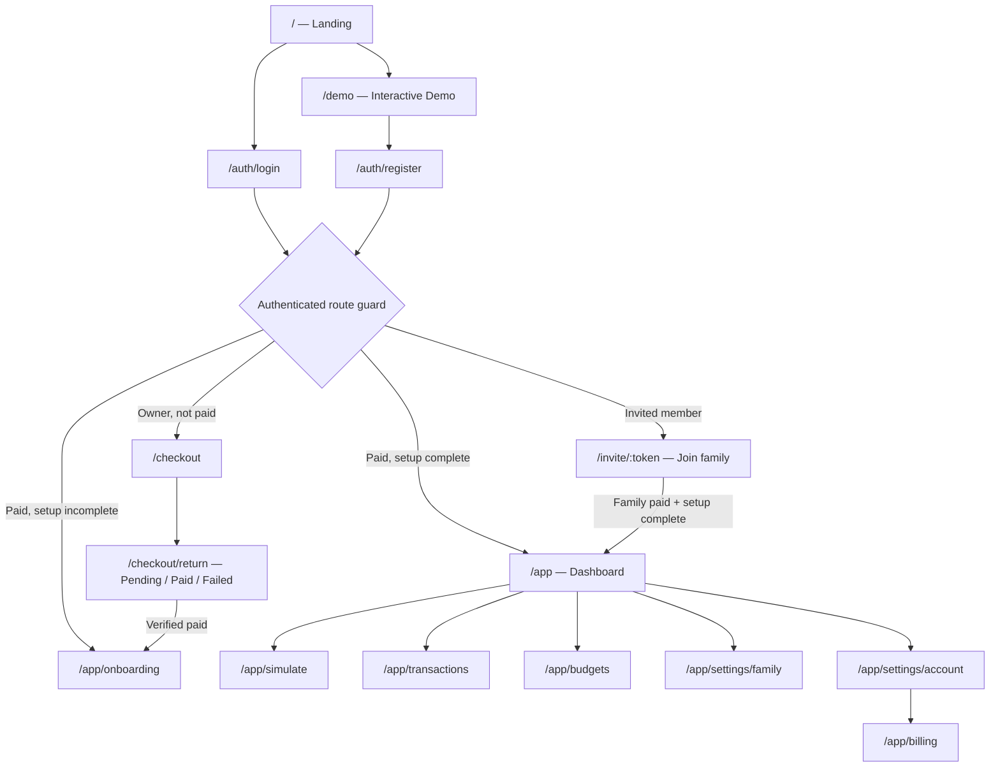
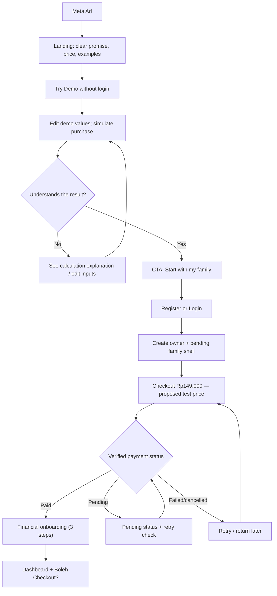
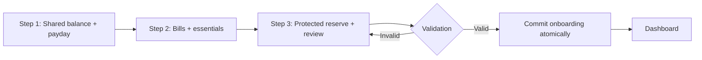
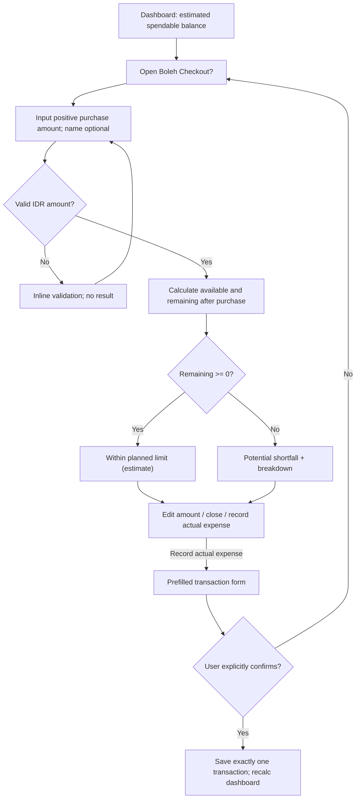

# USER FLOW — Family Finance App

**Version:** 0.1  
**Status:** Proposed — ready for design/engineering review  
**Date:** 2026-10-19  
**Source:** `docs/PRD.md` (MVP v0.1)  
**Platform:** Mobile-first Web App / PWA  
**North-star task:** Find estimated spendable balance and simulate a purchase before payday.

> This document specifies user journeys and states, not final UI implementation or validated purchase behavior. The public demo, paid onboarding, and simulation should be tested with real prospects.

## 1. Actors and permissions

| Actor | Identity | Can do | Cannot do |
|---|---|---|---|
| Visitor | Anonymous | View landing, test public demo, register/login | Save private finance data, view other families |
| Family owner | Authenticated; owns family | Manage shared balance, budgets, transactions, bills; invite partner; manage family purchase | View data from any other family |
| Family member | Authenticated; invited | View and modify shared finances; simulate purchases | Manage payment ownership/invite other users unless explicitly allowed |
| Payment provider | Verified backend webhook | Report payment state to backend | Directly bypass authorization from browser redirects |

**MVP constraints:** One family per user; up to two adult members per family. No personal wallet and no automatic bank integration.

## 2. Information architecture / route map



**Route guard nuance:** Registration as invited member must first resolve the invitation, so the member does not accidentally create or pay for a new family. An expired invitation leads to an explicit recovery screen.

## 3. Core funnel — visitor to paying owner



**Commercial sequence follows PRD v0.1:** public demo → register → checkout → payment verification → onboarding → dashboard. **Design critique:** asking customers to pay before saving their own financial setup may reduce conversion. Marketing should validate this against an alternative setup-before-payment flow, not silently change the implementation.

**Family creation rule for MVP (engineering proposal):** After regular owner registration, create a minimal family shell (`setup_pending`) and bind its purchase/entitlement to that family. Fill its financial attributes only after verified payment. For invitation registration, join the existing family instead of creating a new one.

**Public demo privacy:** Inputs stay in browser memory only, are not transferred into registration, and are not sent to Meta Pixel/analytics. Track only privacy-safe event names such as `demo_started` or `demo_completed`, without entered amounts.

## 4. Onboarding — first-time owner (3 steps)



| Step | Required fields | Optional actions | Validation |
|---|---|---|---|
| 1 — Available money | Shared balance; recurring payday rule | Explain 'shared money'; choose payday date | Non-negative integer IDR; day 1–31 with last-day handling |
| 2 — Essential commitments | Remaining essential needs; unpaid bill total or itemized bills | Add specific bills and due dates | Non-negative values; avoid aggregate + itemized double count |
| 3 — Safety reserve | Protected reserve | Review totals and edit | Allow reserve > balance, but show estimated deficit visibly |

**Decision:** Choose **one** way to represent unpaid bills per period: itemized `bill_occurrences` or a clearly marked one-off combined bill line. Never subtract a raw total and its constituent bill rows together.

**No fabricated accuracy:** If users omit a bill or expense, results are estimates based on supplied data. Onboarding displays an explanation and links to edit data later.

## 5. Core journey — “Boleh Checkout?”



### Calculation contract (single-source-of-truth function)

```
availableToSpend = sharedBalance
                 - unpaidBillsDueBeforeNextPayday
                 - remainingEssentialNeeds
                 - protectedReserve

remainingAfterPurchase = availableToSpend - proposedPurchaseAmount
```

- Compute in **integer IDR** with a deterministic service/shared utility, not duplicated formulas in UI components.
- `availableToSpend` may be negative; show real deficit, **never** clamp it to zero in the risk calculation. A display can say `Rp0 free`, but must also explain the shortfall.
- Future expected income is excluded until received and recorded.
- Simulation is **read-only**. It must not silently alter balances or create transactions.
- If data is old, show `Estimated · balance last checked ...` rather than asserting that a purchase is financially safe.
- Bills with due date after next payday do not enter this cycle's bill sum. Unknown due dates must be handled explicitly; do not silently omit an obligation.
- No user-specific financial amounts should be logged to marketing analytics.

### Financial invariants (critical tests)

| Event | Shared balance | Unpaid bill amount | Remaining essentials | Available-to-spend effect |
|---|---:|---:|---:|---|
| Log income actually received (+100k) | +100k | none | none | +100k |
| Pay an unpaid bill (−100k) | −100k | −100k | none | **Unchanged**; liability was already reserved |
| Record essential spend (−100k) | −100k | none | −100k | **Unchanged**; expense was already budgeted |
| Record discretionary spend (−100k) | −100k | none | none | −100k |
| Reconcile balance from 1m to 900k | −100k adjustment | none | none | −100k |
| Merely run a simulation | none | none | none | **Unchanged** |

**Prevent double counting:** Bill settlement should write one linked expense and mark the occurrence as paid **in one database transaction**. Deleting/editing a linked transaction must reconcile bill status, not leave contradictory data. Essential expenses must map to the correct category/budget once.

## 6. Other journeys

### 6.1 Record expense / income

`Dashboard → Transactions → (+) Add → Choose type → Amount, category, date, note → Save → Updated list & dashboard`

- Fast path: prefill amount/name from “Boleh Checkout?”; user still confirms.
- On network timeout, show a retry state while preserving a client idempotency key; do not duplicate financial records.
- Edits/deletes preserve audit metadata and recalculate the affected cycle.
- Dates outside active cycle must be recorded in the appropriate historical period or clearly rejected if not supported.

### 6.2 Pay a bill

`Budgets & Bills → Due bills → Select bill → Mark paid → Confirm amount/date → Commit linked expense + paid status → Updated totals`

- Disable duplicate submissions and enforce a backend uniqueness/idempotency check.
- Recurring bill templates produce occurrences; paying an occurrence must not mutate the template amount accidentally.
- A paid bill isn't listed in unpaid commitments. Refund/reversal flow is deferred but records must stay internally consistent.

### 6.3 Reconcile shared balance

`Dashboard → Update balance → Enter actual shared balance → Preview adjustment → Confirm → Adjustment transaction + new reconciled timestamp`

- Do not overwrite transaction history.
- A balance adjustment does **not** automatically modify remaining essentials or unpaid bills.
- Show a note that unrecorded expenses may still distort category budgets.

### 6.4 Invite spouse

`Family settings → Invite partner → Generate expiring invite link → Partner opens link → Login/register → Validate token + available seat → Join family → Shared dashboard`

- Maximum two members; no invite when already full.
- Expired/used/invalid token gives a clear error, not a blank screen.
- Membership and seat checks must happen in one backend operation to prevent race conditions.
- Invitations must not reveal sensitive family financial data before authentication and acceptance.

### 6.5 Returning users / entitlement states

| State | Destination |
|---|---|
| Anonymous | Landing or Login |
| Owner created, unpaid | Checkout / purchase status |
| Paid, onboarding unfinished | Resume onboarding |
| Paid, setup complete | Dashboard |
| Invited user, token valid | Join confirmation; no second purchase |
| Invited user, token expired | Invalid invite + request new link |
| Payment provider redirects “success” but webhook pending | Pending verification, **do not unlock** |
| Entitlement revoked/refunded | Access-limited state with payment/support explanation; do not delete data immediately |

## 7. Global navigation (mobile)

After onboarding, use a 4-tab bottom navigation:

- **Beranda** `/app`
- **Transaksi** `/app/transactions`
- **Anggaran** `/app/budgets`
- **Pengaturan** `/app/settings/family` (account/billing nested)

“**Boleh Checkout?**” appears as the **primary CTA** on the dashboard and may be accessible from a persistent quick action; do not replace a core navigation tab if it confuses usage. On desktop, translate these into sidebar navigation without changing route names.

## 8. UX states Codex must implement

| Screen/feature | Loading | Empty | Error | Critical edge state |
|---|---|---|---|---|
| Public demo | Instant local calculation | Pre-filled **clearly labeled sample** | Invalid numbers | Zero/negative available |
| Checkout | Provider redirect | Not purchased | Payment failed | Redirect success while webhook pending |
| Onboarding | Restore draft | No budget data yet | Save fails | Reserve exceeds available balance |
| Dashboard | Skeleton | No finance setup | Retrieval fails | Outdated reconciliation / deficit |
| Simulation | Instant | Placeholder amount | Invalid input | Purchase > available; stale data |
| Transactions | Skeleton | No entries | Save/update fails | Duplicate submit; historical date |
| Bills | Skeleton | No bills | Payment action fails | Paid-but-still-unpaid mismatch |
| Family | Invitation status | No partner | Invite expiry | Max seats / reused token |

## 9. Analytics & privacy event plan (proposal)

| Event | Trigger | Allowed properties |
|---|---|---|
| `landing_cta_clicked` | Click demo CTA | CTA identifier |
| `demo_started` | First demo interaction | Referrer campaign if allowed |
| `demo_completed` | Valid simulation displayed | Generic result bucket (optional, avoid if unnecessary) |
| `registration_completed` | Account created | Auth method, not user finance data |
| `checkout_started` | Checkout initiated | Offer/version identifier |
| `payment_confirmed` | **Backend verified** | Order ID internally; marketing event only per consent/policy |
| `onboarding_completed` | Setup committed | Completion boolean |
| `simulation_used` | Authenticated simulation used | Count only; **no amount/name** |

Personal financial numbers, free-text notes, account balance, expense category, and family details must never be sent to Meta Pixel. Honor consent and applicable privacy requirements.

## 10. Screen IDs & traceability

| ID | Screen | Related PRD feature |
|---|---|---|
| W01 | Landing | F-08, F-09 |
| W02 | Public Demo | F-08, F-04 |
| W03 | Auth | F-01 |
| W04 | Checkout / Payment status | F-09 |
| W05 | Onboarding step 1–3 | F-02 |
| W06 | Dashboard | F-03 |
| W07 | Boleh Checkout? | F-04 |
| W08 | Transactions | F-05 |
| W09 | Add transaction | F-05 |
| W10 | Budgets & Bills | F-06 |
| W11 | Balance reconciliation | F-07 |
| W12 | Family & Account | F-01, F-09 |

## 11. Open decisions before coding / handoff

1. **Commercial flow:** Keep demo → register → pay → onboarding for v0.1; validate alternative with marketing partner.
2. **Authentication:** Email/password or passwordless; email verification and recovery must be specified before implementation.
3. **Bill input:** Use bill rows (preferred) vs one aggregate obligation; ensure they never overlap.
4. **Payday rule:** On nonexistent dates (e.g. day 31 in February), use last day of month — document and test.
5. **Recency warning:** Proposed warning if balance not reconciled for >7 days; tune after usability testing. A recent timestamp does not guarantee precision.
6. **Refund/revocation and data export/deletion:** define policy before first customer pays.
7. **Permissions:** Members may edit shared budget but only owners may invite and manage billing for MVP.

## 12. Definition of ready for UI implementation

- [ ] UX owner approves steps, button labels, and error paths.
- [ ] Engineer reviews the financial invariants and bill linking.
- [ ] Marketing approves exact offer copy and price disclosures.
- [ ] Product team decides email auth, billing, and refund behavior.
- [ ] Wireframes map to every P0 route and state.
- [ ] Codex tasks are split by vertical slice with tests and data boundaries.
